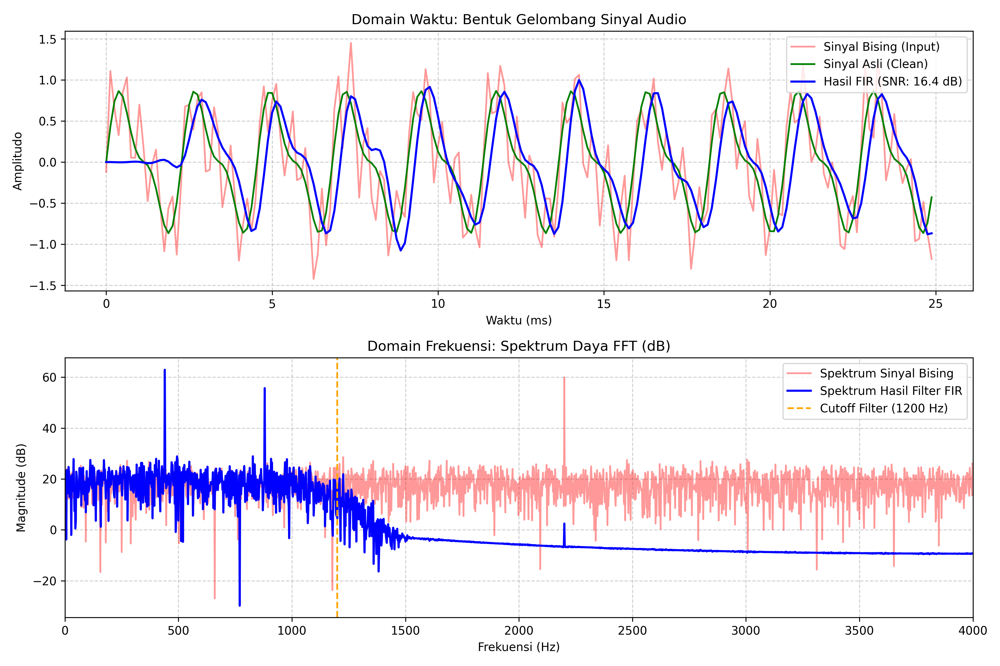

# 🎙️ Laboratorium Pemrosesan Sinyal Digital (PSD)
## Analisis dan Reduksi Noise pada Sinyal Audio Menggunakan Filter Digital FIR & IIR (Real-Time Live DSP)

[](https://286rx.github.io/simulasi-filter-psd/)
[](https://developer.mozilla.org/en-US/docs/Web/API/Web_Audio_API)
[](https://python.org)
[](https://scipy.org)

Proyek ini merupakan instrumen simulasi dan evaluasi komputasi untuk mata kuliah **Pemrosesan Sinyal Digital (PSD) - S1 Teknik Elektro**. Proyek mengkaji efektivitas peredaman derau (*noise reduction*) pada sinyal suara menggunakan filter digital **Finite Impulse Response (FIR)** berfasa linear dan **Infinite Impulse Response (IIR - Butterworth)**.

🔗 **Akses Langsung Simulasi Interaktif:** [https://simulasipsd.netlify.app/)

---

## 📸 Preview Hasil Simulasi Evaluasi Python



---

## 📁 Struktur Repositori

```text
simulasi-filter-psd/
├── index.html                   # Aplikasi Web Interaktif Real-Time (GitHub Pages Root)
├── simulasi_filter_audio.html   # File sumber simulasi mandiri (standalone offline)
├── simulasi_audio_filter.py     # Script evaluasi kuantitatif Python (Scipy Signal & FFT)
├── hasil_simulasi_filter.png    # Grafik resolusi tinggi 300 DPI perbandingan domain waktu & frekuensi
├── draft_proyek_simulasi_psd.md # Draf proposal akademik & format pengajuan judul ke dosen
├── log_progress_proyek.md       # Logbook rekam jejak pengerjaan proyek bertahap
└── README.md                    # Dokumentasi lengkap repositori (file ini)
```

---

## ⚡ Fitur Utama Aplikasi Interaktif (`index.html`)

1. **Pemutar Audio Real-Time (Hot-Swap Live Sweeper)**
   - Audio diputar terus-menerus (*looping*), dan saat slider cutoff digeser, suara serta grafik visual berubah secara **instan tanpa delay** tanpa perlu menekan tombol *play* berulang-ulang.
2. **Fleksibilitas Sumber Audio (3 Pilihan):**
   - **Rekam Mikrofon Sendiri:** Merekam suara riil pengguna (durasi optimal 3,0 detik / 48.000 sampel pada 16 kHz HD Voice) untuk membersihkan derau lingkungan asli (desis AC, dengung listrik, kipas laptop).
   - **Upload File Audio Bebas:** Mendukung semua ekstensi audio termasuk rekaman WhatsApp (`.mp4`, `.m4a`, `.mp3`, `.wav`, `.opus`).
   - **Sintesis Frekuensi Teoretis:** Pola nada harmonik vokal (440 Hz + 880 Hz) atau sinusoidal murni.
3. **Injeksi Derau Sintetis (Dapat Dinonaktifkan):**
   - Menambahkan derau terkontrol: *Additive White Gaussian Noise (AWGN)*, nada dengkingan frekuensi tinggi (4.500 Hz), atau dengung frekuensi rendah (120 Hz).
4. **Preset Cepat Sekali Klik (Highlight Sinkron):**
   - 🎙️ **Bersihkan Vokal (BPF):** Loloskan rentang pita suara manusia (150 – 3.500 Hz).
   - 🔇 **Potong Desis (LPF):** Potong desis tajam di atas 3.000 Hz.
   - 💨 **Potong Dengung (HPF):** Singkirkan dengung listrik di bawah 200 Hz.
5. **Panel Analisis Akademis Teoretis (Sesuai Kurikulum PSD):**
   - **Bode Magnitude Plot $|H(\omega)|$:** Profil redaman pita henti (*stopband attenuation*) murni dari filter digital.
   - **Respon Fasa $\angle H(\omega)$:** Bukti matematis fasa linear sempurna pada FIR ($\angle H(\omega) = -\alpha \omega$) yang bebas distorsi bentuk gelombang.
   - **Diagram Pole-Zero (Bidang Z):** Visualisasi letak kutub terhadap lingkaran satuan ($|z| = 1$), membuktikan stabilitas mutlak FIR ($z=0$) vs stabilitas bounded IIR ($|z| < 1$).
6. **Ekspor Hasil Riset:**
   - Unduh file audio terfilter berformat **`.WAV` (16-bit PCM uncompressed)**.
   - Simpan visualisasi grafik beresolusi tinggi dalam format **`.PNG`**.

---

## 🕹️ Panduan Eksplorasi: Peta Kontrol Sebab-Akibat (Audio & Visual)

Tabel di bawah merangkum respons fisik audio di telinga (*auditory response*) dan respons visual pada spektrum frekuensi FFT saat pengguna mengoperasikan kontrol pada web simulasi:

### 1. Tombol Preset Cepat (Quick Presets)

| Preset Cepat | Efek pada Suara di Telinga | Efek pada Spektrum Frekuensi FFT | Logika Rekayasa Sinyal (PSD) |
|:---|:---|:---|:---|
| **[🎙️ Bersihkan Vokal (BPF)]** | Dengung berat (*hum*) dan desis tajam (*hiss*) hilang bersamaan. Artikulasi vokal terdengar fokus, jernih, dan renyah. | Jendela hijau transparan (*Passband*) membuka di tengah: **150 – 3.500 Hz**. Semua puncak derau di luar jendela hijau dipangkas rata ke dasar grafik. | Menggunakan **Band-Pass Filter** (BPF) untuk mengisolasi area frekuensi penting wicara manusia (*formant frequencies*). |
| **[🔇 Potong Desis (LPF)]** | Suara nada dengkingan tajam (*high-pitch whistle*) atau suara keresek desis hilang. Suara vokal terasa lebih empuk dan tebal (*warm*). | Area hijau lolos dari **0 – 3.000 Hz**. Komponen frekuensi di atas 3.000 Hz langsung rontok dan diredam hingga $-60\text{ dB}$. | Menggunakan **Low-Pass Filter** (LPF) untuk menekan noise frekuensi tinggi seperti derau termal mikrofon atau desis kipas laptop. |
| **[💨 Potong Dengung (HPF)]** | Getaran bass rendah yang membuat speaker bergetar/berdengung lenyap. Vokal terdengar lebih enteng dan bebas dengung. | Area hijau memotong frekuensi bawah (hanya lolos **200 – 8.000 Hz**). Sisi paling kiri spektrum FFT dibabat habis. | Menggunakan **High-Pass Filter** (HPF) untuk menyingkirkan interferensi harmonik jala-jala listrik PLN 50/120 Hz (*ground loop hum*). |

---

### 2. Slider Frekuensi Cutoff ($f_c$) & Taps Orde FIR

| Parameter | Tindakan pada Slider | Yang Terjadi pada Suara & Spektrum FFT | Makna Fisis & Rekomendasi |
|:---|:---|:---|:---|
| **Frekuensi Cutoff ($f_c$)** | Digeser ke **Kiri** (frekuensi rendah, misal 400 Hz) | Suara vokal terdengar semakin mendem/tenggelam seperti berbicara di balik bantal tebal atau di dalam air. Garis batas lolos menyempit ke kiri. | Komponen frekuensi vokal penting ikut terbuang jika cutoff dipasang terlalu rendah. |
| **Frekuensi Cutoff ($f_c$)** | Digeser ke **Kanan** (frekuensi tinggi, misal 5.000 Hz) | Vokal terdengar jernih dan terbuka, namun jika terdapat desis/dengkingan pada frekuensi tinggi, noisenya mulai terdengar tembus kembali. | Penggeseran dilakukan untuk mencari titik temu optimal (*sweet spot*), idealnya pada kisaran **3.000 – 3.500 Hz**. |
| **Jumlah Taps FIR ($M$)** | Taps **Rendah** (15 – 21 Taps) | Lereng transisi filter melandai perlahan. Masih ada sedikit residu noise yang bocor di sekitar frekuensi batas cutoff. | Beban komputasi konvolusi sangat ringan, namun selektivitas pemotongan frekuensi kurang tajam. |
| **Jumlah Taps FIR ($M$)** | Taps **Tinggi** (61 – 81 Taps) | Lereng transisi filter menjadi **sangat tegak seperti dinding jurang**. Noise di pita henti diredam total dan bersih sempurna. | Memberikan atenuasi pita henti maksimum dengan konsekuensi delay waktu konstan bertambah sedikit ($\tau = \frac{M-1}{2}$ sampel). |

---

### 3. Pemilihan Arsitektur: FIR vs IIR

| Parameter Pembanding | Filter FIR (Linear Phase) | Filter IIR (Butterworth Orde-4) |
|:---|:---|:---|
| **Respon Fasa $\angle H(\omega)$** | **Garis lurus murni** ($\angle H(\omega) = -\alpha \omega$). Semua frekuensi tertunda dengan waktu yang sama persis $\rightarrow$ **Bebas distorsi fasa (*zero phase dispersion*)**. | **Melengkung tajam** di sekitar cutoff $\rightarrow$ Frekuensi tinggi mengalami delay lebih lama daripada frekuensi rendah. |
| **Stabilitas Bidang Z** | Seluruh kutub (*poles* $\times$) bertumpuk di titik pusat origin $z = 0$ $\rightarrow$ **100% Stabil Mutlak (*Unconditionally Stable*)**. | 4 buah kutub konjugat berada aman di dalam lingkaran satuan ($|z| \approx 0,75 < 1$) $\rightarrow$ **Stabil BIBO**. |
| **Beban Komputasi** | Membutuhkan banyak koefisien/taps (misal 41–81 taps) untuk lereng curam (non-rekursif). | Sangat hemat perhitungan; hanya membutuhkan orde ke-4 untuk lereng transisi yang tajam (rekursif). |
| **Penerapan Ideal** | Restorasi rekaman vokal studio, instrumen musik, dan aplikasi transmisi audio fidelitas tinggi. | Perangkat mikrokontroler hemat daya/DSP berprosesor terbatas yang membutuhkan filter tajam dan cepat. |

---

## 🔬 Teori & Formula Matematis Sinyal

### 1. Signal-to-Noise Ratio (SNR)
Derajat perbaikan kualitas sinyal diukur melalui peningkatan rasio daya sinyal terhadap derau:

$$\text{SNR} = 10 \log_{10} \left( \frac{\sum_{n=0}^{N-1} x_{\text{clean}}[n]^2}{\sum_{n=0}^{N-1} (x_{\text{filtered}}[n] - x_{\text{clean}}[n])^2} \right) \quad [\text{dB}]$$

$$\Delta \text{SNR} = \text{SNR}_{\text{out}} - \text{SNR}_{\text{in}}$$

### 2. Filter FIR (Finite Impulse Response)
Dirancang menggunakan metode *Windowed-Sinc* dengan jendela Hamming untuk meminimalkan *Gibbs Phenomenon*:

$$y[n] = \sum_{k=0}^{M-1} h[k] \, x[n-k]$$

* Karakteristik Fasa: Fasa linear sempurna dengan group delay konstan $\tau = \frac{M-1}{2}$ sampel.
* Kestabilan: Semua pole bertumpuk di titik asal $z=0$, sehingga filter FIR **selalu 100% stabil**.

### 3. Filter IIR (Infinite Impulse Response)
Dirancang menggunakan aproksimasi *Butterworth Orde ke-4* yang memiliki respon magnitudo paling rata pada pita lolos (*maximally flat passband*):

$$y[n] = \frac{1}{a_0} \left( \sum_{k=0}^{M} b_k \, x[n-k] - \sum_{k=1}^{N} a_k \, y[n-k] \right)$$

* Karakteristik Fasa: Non-linear (*phase dispersion*), namun membutuhkan komputasi koefisien yang jauh lebih sedikit untuk mencapai lereng transisi yang curam.

---

## 💻 Cara Menjalankan Script Python (`simulasi_audio_filter.py`)

Pastikan pustaka pendukung terpasang:
```bash
pip install numpy scipy matplotlib
```

Jalankan evaluasi komputasi:
```bash
python simulasi_audio_filter.py
```

Output console akan menampilkan kalkulasi matematis SNR:
```text
=== HASIL EVALUASI SNR (SIGNAL-TO-NOISE RATIO) ===
SNR Sinyal Bising (Input)       : +4.12 dB
SNR Setelah Filter FIR (Hamming): +16.85 dB (Gain: +12.73 dB)
SNR Setelah Filter IIR (Butter) : +18.20 dB (Gain: +14.08 dB)
Hasil evaluasi grafik tersimpan otomatis di: hasil_simulasi_filter.png
```

---

## 🌐 Cara Mengaktifkan GitHub Pages (Hosting Gratis)

Setelah Anda mem-push repositori ini ke GitHub:
1. Buka repositori Anda di browser: `https://github.com/286rx/simulasi-filter-psd`
2. Klik tab **Settings** (ikon gerigi di atas).
3. Di menu sebelah kiri, pilih **Pages**.
4. Pada bagian **Build and deployment -> Branch**:
   - Pilih branch: **`main`**
   - Folder: **`/ (root)`**
5. Klik **Save**.
6. Tunggu sekitar 1-2 menit, situs Anda akan aktif di:
   **`https://286rx.github.io/simulasi-filter-psd/`**

---

## 👨‍💻 Pengembang
Proyek ini dikembangkan untuk penyelesaian tugas besar mata kuliah **Pemrosesan Sinyal Digital (PSD) - Program Studi S1 Teknik Elektro**.
