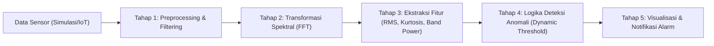

# Draf Usulan dan Rencana Proyek Simulasi
## Mata Kuliah Pemrosesan Sinyal Digital (PSD) — S1 Teknik Elektro

Dokumen ini disusun sebagai panduan pemilihan judul proyek berbasis simulasi (*MATLAB / Python / Simulink*), mengacu pada silabus standar PSD serta daftar rekomendasi prioritas semester.

---

## 1. Matriks Skala Prioritas Proyek

| Prioritas | Bidang Aplikasi | Usulan Judul Proyek Simulasi | Tingkat Kesulitan | Kelayakan 1 Semester |
| :---: | :--- | :--- | :---: | :---: |
| **A** | **Audio & Filtering** | Simulasi dan Analisis Reduksi Noise pada Sinyal Audio Menggunakan Filter Digital FIR dan IIR | Dasar – Menengah | ★★★★★ (Sangat Aman) |
| **B** | **Spektrum & Nada** | Simulasi Analisis Spektrum Frekuensi Sinyal Suara dan Deteksi Frekuensi Dominan Berbasis FFT | Dasar – Menengah | ★★★★★ (Sangat Terukur) |
| **C** | **Vibrasi Industri** | Simulasi Analisis Spektrum Getaran Mesin Menggunakan FFT untuk Deteksi Kondisi Mesin (*Condition Monitoring*) | Menengah | ★★★★☆ (Relevan Industri) |
| **D** | **Sensor Pipeline (PAOS)** | Pengembangan Sistem Digital Signal Processing untuk Analisis dan Deteksi Anomali Sinyal Sensor Industri | Menengah – Lanjut | ★★★★☆ (Bobot Nilai Maksimal) |

---

## 2. Rincian Teknis Tiap Prioritas

### Prioritas A: Audio & Filter Digital (FIR vs IIR)
> [!NOTE]
> **Rekomendasi Utama:** Paling ideal jika ingin fokus pada implementasi matematis filter digital standar tanpa risiko kesulitan mendapatkan data sinyal riil.

* **Fokus Utama:** Perancangan filter digital dan evaluasi rasio sinyal terhadap derau (*Signal-to-Noise Ratio* / SNR).
* **Konsep Inti:**
  * Teorema Sampling Nyquist-Shannon & Aliasing.
  * Desain Filter FIR (Windowing: Rectangular, Hamming, Hanning, Blackman).
  * Desain Filter IIR (Butterworth, Chebyshev Type I/II, Elliptic).
  * Respon Frekuensi: Magnitude, Phase, Group Delay.
* **Skenario Simulasi:**
  1. Pembangkitan/pembacaan sinyal audio bersih (`.wav` atau multi-tone sintetis).
  2. Kontaminasi sinyal dengan derau buatan (*Additive White Gaussian Noise* / AWGN dan *50 Hz power-line hum*).
  3. Pemrosesan sinyal melalui filter digital yang telah dirancang.
  4. Analisis kuantitatif peningkatan SNR dan perbandingan performa FIR vs IIR (fasa linear vs efisiensi komputasi).

---

### Prioritas B: Analisis Spektrum Frekuensi & Deteksi Nada (FFT)
> [!TIP]
> **Kelebihan:** Sangat kuat pada aspek visualisasi (domain waktu vs domain frekuensi) dan verifikasi fisisnya sangat langsung.

* **Fokus Utama:** Transformasi sinyal domain waktu ke frekuensi dan identifikasi komponen harmonik.
* **Konsep Inti:**
  * Discrete Fourier Transform (DFT) dan Fast Fourier Transform (FFT).
  * Efek Windowing dan *Spectral Leakage*.
  * Resolusi Frekuensi ($\Delta f = F_s / N$).
  * Algoritma *Peak Detection* (Pencarian Frekuensi Dominan).
* **Skenario Simulasi Alternatif (Pilih salah satu):**
  * **Opsi Sinyal Suara:** Analisis formulan vokal manusia dan ekstraksi *pitch*.
  * **Opsi DTMF (*Dual-Tone Multi-Frequency*):** Simulasi decoder nada tombol telepon matriks $4 \times 3$ menggunakan FFT atau Algoritma Goertzel.

---

### Prioritas C: Analisis Getaran Mesin (*Machine Condition Monitoring*)
* **Fokus Utama:** Deteksi dini anomali pada sistem mekanik/elektrik (motor induksi, poros, atau *bearing*) melalui profil getaran.
* **Konsep Inti:**
  * Komponen frekuensi fundamental rotasi ($1\times, 2\times, 3\times$ RPM).
  * Frekuensi karakteristik cacat bantalan (*Bearing Fault Frequencies*: BPFO, BPFI, BSF, FTF).
  * *Envelope Analysis* (Hilbert Transform) untuk modulasi getaran impulsif.
* **Skenario Simulasi:**
  * Pemodelan matematis sinyal getaran motor sehat vs motor mengalami *unbalance*, *misalignment*, atau keausan *bearing*.
  * Plot *Power Spectral Density* (PSD) untuk mendeteksi lonjakan energi pada frekuensi kritis.

---

### Prioritas D: End-to-End DSP Sensor Industri (Rekomendasi Integrasi)
> [!IMPORTANT]
> **Catatan Dokumen Acuan:** Judul ini adalah judul paling komprehensif dan fleksibel untuk integrasi sistem (misal: PAOS), karena mencakup siklus pemrosesan sinyal lengkap dari hulu ke hilir.

* **Fokus Utama:** Membangun *pipeline* terpadu dari akuisisi/simulasi data sensor hingga menghasilkan keputusan deteksi anomali.
* **Arsitektur Pipeline:**



* **Parameter Evaluasi Anomali:**
  * Domain Waktu: Nilai RMS, *Crest Factor*, *Kurtosis*.
  * Domain Frekuensi: Pergeseran frekuensi dominan, kenaikan energi spektral pada pita frekuensi tinggi (*High-Frequency Spectral Energy*).

---

## 3. Perbandingan Beban Komputasi dan Kebutuhan Alat

| Aspek | Prioritas A (Audio) | Prioritas B (FFT/DTMF) | Prioritas C (Vibrasi) | Prioritas D (Sensor Industri) |
| :--- | :--- | :--- | :--- | :--- |
| **Kebutuhan Data** | File `.wav` atau sintetis | File `.wav` nada | Sinyal sintetis / Dataset CWRU | Data deret waktu (*time-series*) |
| **Pustaka Python** | `numpy`, `scipy.signal`, `soundfile` | `numpy`, `scipy.fft`, `matplotlib` | `numpy`, `scipy.signal`, `scipy.fft` | `numpy`, `pandas`, `scipy`, `matplotlib` |
| **Toolbox MATLAB** | *Signal Processing Toolbox* | *Signal Processing Toolbox* | *Predictive Maintenance / DSP* | *Signal Processing / DSP System* |
| **Tingkat Kompleksitas Kode** | Rendah – Sedang | Rendah | Sedang | Sedang – Lanjut |

---

## 4. Draf Formulir Pengajuan Judul (Siap Kirim ke Dosen)

```markdown
Yth. Dosen Pengampu / Pembimbing Mata Kuliah Pemrosesan Sinyal Digital,

Saya bermaksud mengajukan usulan judul proyek akhir berbasis simulasi:

1. Usulan Utama (Prioritas D):
   "Pengembangan Sistem Digital Signal Processing untuk Analisis dan Deteksi Anomali Sinyal Sensor Industri"
   Deskripsi Singkat:
   Membangun simulasi pemrosesan sinyal sensor secara berurutan, dimulai dari filtering derau,
   analisis spektral menggunakan Fast Fourier Transform (FFT), ekstraksi fitur domain waktu dan
   frekuensi, hingga penentuan ambang batas anomali otomatis.

2. Usulan Alternatif 1 (Prioritas A):
   "Simulasi dan Analisis Perbandingan Filter FIR dan IIR dalam Mereduksi Noise pada Sinyal Audio"
   Deskripsi Singkat:
   Merancang filter digital low-pass/band-pass menggunakan metode windowing (FIR) dan aproksimasi
   Butterworth (IIR) untuk mengevaluasi peningkatan Signal-to-Noise Ratio (SNR) pada sinyal audio.

3. Usulan Alternatif 2 (Prioritas C):
   "Simulasi Analisis Spektrum Getaran Menggunakan FFT untuk Deteksi Kondisi dan Gangguan Motor Listrik"
   Deskripsi Singkat:
   Mensimulasikan sinyal getaran motor normal vs gangguan mekanis serta mengidentifikasi frekuensi
   kerusakan berbasis analisis spektrum daya FFT.

Mohon pertimbangan dan masukan dari Bapak/Ibu terkait opsi yang paling tepat untuk dilaksanakan.
Terima kasih.
```
