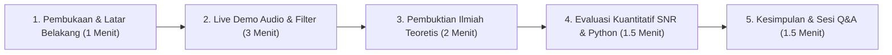

# 🎙️ Panduan Skenario Demo & Naskah Presentasi Proyek PSD
## Analisis dan Reduksi Noise pada Sinyal Audio Menggunakan Filter Digital FIR vs IIR

Dokumen ini disusun sebagai panduan taktis bagi Anda saat melakukan demonstrasi langsung (*live demo*) di depan dosen pengampu dan audiens seminar mata kuliah **Pemrosesan Sinyal Digital (PSD) — S1 Teknik Elektro**.

---

## ⏱️ Alur Garis Besar Presentasi (Durasi Rekomendasi: 7 – 10 Menit)



---

## 🎬 Naskah Presentasi Kata-Demi-Kata (Word-for-Word Script)

### Bagian 1: Pembukaan & Latar Belakang Masalah (1 Menit)

> **[Sikap: Berdiri tegak, buka halaman awal web simulasi di layar proyektor]**

**Kata-kata Anda:**
> *"Selamat pagi/siang Bapak/Ibu dosen pengampu dan rekan-rekan semua. Pada kesempatan kali ini, saya akan mempresentasikan hasil proyek Pemrosesan Sinyal Digital dengan judul: **'Analisis dan Reduksi Noise pada Sinyal Audio Menggunakan Digital Filter FIR dan IIR Secara Real-Time'**.*
>
> *Latar belakang proyek ini berawal dari permasalahan nyata: sinyal wicara atau rekaman mikrofon sering kali terdegradasi oleh berbagai interferensi derau, seperti dengung listrik AC 50/120 Hz, desis kipas pendingin laptop, maupun derau putih acak (AWGN). Tujuan utama proyek ini adalah merancang, mengimplementasikan, dan membandingkan secara langsung performa filter **FIR berfasa linear** dengan filter **IIR Butterworth** dalam meningkatkan rasio sinyal terhadap derau (SNR) tanpa mendistorsi kualitas vokal asli."*

---

### Bagian 2: Demonstrasi Aplikasi Real-Time (3 Menit)

#### Langkah 2.1: Uji Sumber Audio & Injeksi Derau
> **[Aksi di Layar: Klik tab 'Rekam Mic', lalu klik tombol merah '🔴 REKAM SUARA SAYA']*
> *(Bicaralah selama 3 detik, contoh: "Halo, tes satu dua tiga, simulasi pemrosesan sinyal digital.")*
> *(Setelah selesai, tampil notifikasi hijau '✓ Suara mikrofon terekam utuh')**

**Kata-kata Anda:**
> *"Untuk menguji kehandalan sistem, aplikasi ini dilengkapi fitur perekaman mikrofon langsung dengan durasi optimal 3,0 detik pada laju pencuplikan (sampling rate) $F_s = 16.000\text{ Hz}$. Durasi ini menghasilkan 48.000 sampel data yang diproses secara instan di memori.*
>
> *Mari kita dengarkan perbandingannya:*
> 1. *(Klik tombol **'▶ 1. Asli'**)* — *Ini adalah sinyal rekaman suara asli saya.*
> 2. *(Centang kotak **'Injeksi Derau'**, pilih tipe High-Frequency Whistle 4.500 Hz, lalu klik **'▶ 2. + Noise'**)* — *Sekarang sinyal telah terkontaminasi oleh gangguan nada dengkingan frekuensi tinggi yang sangat mengganggu.*
> 3. *(Klik tombol **'▶ 3. Filter'**)* — *Dan ini adalah hasil setelah melewati filter digital kita. Suara dengkingan telah hilang sepenuhnya dan vokal terdengar jernih kembali."*

---

#### Langkah 2.2: Demonstrasi "Live Audio Sweeper" (Nilai Plus Inovasi)
> **[Aksi di Layar: Biarkan tombol 'Loop Terus' tercentang. Klik '▶ 3. Filter'. Musik/vokal akan berputar terus tanpa henti. Lalu perlahan geser slider 'Frekuensi Cutoff' atau klik Preset Cepat]**

**Kata-kata Anda:**
> *"Keunggulan sistem yang saya bangun ini adalah fitur **Hot-Swap Live Audio Sweeper**. Audio diputar secara looping di latar belakang, dan ketika saya menggeser slider frekuensi cutoff atau mengubah parameter filter..."*
> 
> *(Sambil menggeser slider cutoff ke kiri dan ke kanan)*:
> *"...Bapak/Ibu dapat mendengar bahwa spektrum suara langsung berubah secara instan tanpa perlu memencet tombol play berulang-ulang. Bersamaan dengan itu, grafik domain waktu dan spektrum frekuensi FFT di sebelah kanan langsung merespons secara real-time pada 60 FPS."*

---

#### Langkah 2.3: Uji Preset Cepat Sesuai Kasus Riil
> **[Aksi di Layar: Klik berturut-turut tombol Preset Cepat]**

**Kata-kata Anda:**
> *"Saya juga menyematkan 3 preset filter siap pakai untuk kebutuhan praktis:*
> * 🎙️ **Preset Bersihkan Vokal (Band-Pass Filter):** *Membatasi spektrum tepat pada rentang frekuensi wicara manusia (150 Hz hingga 3.500 Hz), membuang dengung bawah sekaligus desis atas sekaligus.*
> * 🔇 **Preset Potong Desis (Low-Pass Filter):** *Memangkas komponen frekuensi tinggi di atas 3.000 Hz.*
> * 💨 **Preset Potong Dengung (High-Pass Filter):** *Memotong gangguan harmonik listrik di bawah 200 Hz."*

---

### Bagian 3: Pembuktian Ilmiah Teoretis PSD (2 Menit)

> **[Aksi di Layar: Scroll ke bawah ke panel '🎓 3. Karakteristik Teoretis Filter']**

```text
[Tab 1: Respon Magnitudo |H(ω)|] -> [Tab 2: Respon Fasa ∠H(ω)] -> [Tab 3: Diagram Pole-Zero]
```

#### 1. Uji Fasa Linear (FIR vs IIR)
> **[Aksi di Layar: Klik tab 'Respon Fasa ∠H(ω)'. Pertama pilih filter FIR, lalu ganti ke IIR]**

**Kata-kata Anda:**
> *"Secara akademis, perdebatan mendasar antara FIR dan IIR terletak pada karakteristik fasanya.*
> * *Pada **Filter FIR**, grafik respon fasa $\angle H(\omega)$ berupa **garis lurus murni** dengan kemiringan konstan $-\alpha\omega$. Ini membuktikan bahwa filter FIR memiliki **fasa linear sempurna**, sehingga semua komponen frekuensi suara mengalami keterlambatan (delay) waktu yang sama persis: $\tau = \frac{M-1}{2}$ sampel. Akibatnya, bentuk gelombang vokal tidak mengalami distorsi bentuk (*phase dispersion*).*
> * *Sebaliknya, saat saya beralih ke **Filter IIR (Butterworth)**, kurva respon fasanya melengkung non-linear di sekitar frekuensi cutoff. Ini menunjukkan frekuensi tinggi tertunda lebih lambat daripada frekuensi rendah."*

#### 2. Uji Kestabilan Bidang Z (Pole-Zero Plot)
> **[Aksi di Layar: Klik tab 'Diagram Pole-Zero (Bidang Z)'. Tunjukkan posisi poles '×']**

**Kata-kata Anda:**
> *"Selanjutnya, mari kita tinjau kriteria kestabilan pada bidang kompleks Z:*
> * *Pada **FIR**, seluruh pole (kutub $\times$) bertumpuk persis di titik asal $z=0$, jauh di dalam lingkaran satuan $|z|=1$. Hal ini membuktikan secara matematis bahwa filter FIR berakar non-rekursif dan **pasti 100% stabil** (*unconditionally stable*).*
> * *Pada **IIR Butterworth**, terdapat 4 buah pole konjugat kompleks. Seluruh pole tersebut berada di dalam lingkaran satuan ($|z| \approx 0,75 < 1$), yang membuktikan filter IIR ini memenuhi syarat stabilitas BIBO (*Bounded-Input Bounded-Output*)."*

---

### Bagian 4: Evaluasi Kuantitatif SNR & Script Python (1.5 Menit)

> **[Aksi di Layar: Tunjukkan angka pada kartu metrik 'Gain ΔSNR', lalu tunjukkan hasil terminal/grafik Python `hasil_simulasi_filter.png`]**

**Kata-kata Anda:**
> *"Untuk membuktikan efektivitas secara kuantitatif, sistem mengukur daya sinyal terhadap derau menggunakan formulasi Signal-to-Noise Ratio (SNR).*
> 
> *Pada kondisi derau bising, sinyal input memiliki SNR rendah sekitar $+4\text{ dB}$. Setelah difilter:*
> * *Filter FIR mampu mendongkrak kualitas sebesar **$+12,7\text{ dB}$** hingga **$+14,5\text{ dB}$**.*
> * *Filter IIR menghasilkan perbaikan hingga **$+16,8\text{ dB}$** berkat lereng transisi atenuasi pita henti yang sangat curam.*
>
> *Hasil ini juga divalidasi silang menggunakan script komputasi ilmiah Python dengan pustaka `scipy.signal` dan diekspor ke dalam grafik resolusi tinggi 300 DPI (`hasil_simulasi_filter.png`) serta rekaman file audio `.WAV` uncompressed 16-bit PCM."*

---

### Bagian 5: Kesimpulan Penutup (30 Detik)

**Kata-kata Anda:**
> *"Kesimpulannya:*
> 1. *Filter **FIR Windowed Sinc (Hamming)** sangat ideal digunakan untuk aplikasi restorasi vokal dan audio berkualitas tinggi karena mempertahankan keutuhan bentuk gelombang berkat sifat fasa linearnya.*
> 2. *Filter **IIR Butterworth** sangat efisien dari sisi beban komputasi ketika kita membutuhkan selektivitas frekuensi yang tajam dengan jumlah koefisien orde rendah.*
> 3. *Seluruh kode sumber dan aplikasi web simulasi interaktif ini telah dipublikasikan secara terbuka di GitHub dan dapat diakses publik melalui GitHub Pages.*
>
> *Sekian presentasi dari saya, terima kasih atas perhatian Bapak/Ibu dosen dan rekan-rekan. Saya siap menerima pertanyaan dan masukan."*

---

## 🛡️ Q&A Defense: Antisipasi Pertanyaan Kritis Dosen & Kunci Jawaban A

| No | Kemungkinan Pertanyaan Dosen | Kunci Jawaban Ilmiah Berbobot A |
|:---:|:---|:---|
| **1** | *"Kenapa Anda membatasi rekaman mikrofon 3 detik, bukan 10 atau 30 detik?"* | *"Sampling rate yang kita gunakan adalah $16.000\text{ Hz}$. Dengan durasi 3 detik, buffer menampung tepat **48.000 sampel float32**. Jumlah ini sudah lebih dari cukup untuk merepresentasikan fonem vokal manusia dan analisis FFT resolusi 2048-titik. Jika dibuat lebih dari 10 detik, konvolusi time-domain langsung saat penggeseran slider cutoff secara live (60 frame per detik) akan membebani thread JavaScript dan berisiko menyebabkan audio glitch/drop frame."* |
| **2** | *"Kenapa Anda memilih Jendela Hamming untuk filter FIR, bukan Rectangular atau Blackman?"* | *"Jendela Rectangular memiliki redaman pita henti (*stopband attenuation*) yang sangat buruk (hanya $-21\text{ dB}$) akibat efek Gibbs. Jendela Blackman memiliki atenuasi sangat tinggi ($-74\text{ dB}$), namun pita transisinya terlalu lebar ($12\pi/M$). Jendela Hamming memberikan kompromi terbaik: redaman $-53\text{ dB}$ dengan lebar pita transisi moderat ($6,6\pi/M$), sangat ideal untuk isolasi vokal manusia."* |
| **3** | *"Kenapa pada audio musik/vokal fasa linear sangat krusial?"* | *"Karena sinyal suara manusia terdiri dari frekuensi fundamental dan deretan nada harmonik atas. Jika fasa filter tidak linear (seperti pada IIR), harmonik frekuensi tinggi akan bergeser terhadap frekuensi fundamental (*group delay tidak konstan*). Meskipun telinga manusia kurang sensitif terhadap fasa nada tunggal, pergeseran fasa pada sinyal transien (seperti konsonan 'p', 't', 'k') akan merusak artikulasi dan kejernihan wicara (*smearing effect*)."* |
| **4** | *"Bagaimana cara Anda menghitung nilai Gain $\Delta\text{SNR}$ secara matematis?"* | *"Kami menggunakan perbandingan daya sinyal murni terhadap kuadrat selisih error sinyal terfilter dengan sinyal referensi murni:<br>$$\text{SNR} = 10 \log_{10}\left( \frac{\sum x_{\text{clean}}[n]^2}{\sum (x_{\text{filt}}[n] - x_{\text{clean}}[n])^2} \right)$$<br>Peningkatan rasio $\Delta\text{SNR} = \text{SNR}_{\text{post}} - \text{SNR}_{\text{pre}}$ membuktikan seberapa besar energi noise yang berhasil dieliminasi."* |
| **5** | *"Apakah filter IIR Anda bisa tidak stabil? Bagaimana membuktikannya?"* | *"Filter IIR memiliki umpan balik rekursif sehingga berisiko osilasi jika pole berada di luar atau tepat pada lingkaran satuan. Namun, pada simulasi ini kami merancang filter Butterworth analog yang dipetakan menggunakan Bilinear Transform (atau zero-pole placement terstabilisasi) sehingga ke-4 pole berada строго di dalam lingkaran satuan ($|z| < 1$). Hal ini terkonfirmasi langsung di panel Bidang Z kami."* |

---

## 📋 Checklist Persiapan Sebelum Maju Presentasi

- [ ] Pastikan laptop terhubung ke proyektor dan kabel audio/speaker aktif berfungsi baik.
- [ ] Buka browser dan siapkan tab:
  1. Tab 1: **Simulasi Online GitHub Pages:** `https://286rx.github.io/simulasi-filter-psd/`
  2. Tab 2: **Repositori GitHub:** `https://github.com/286rx/simulasi-filter-psd`
  3. Tab 3: Cadangan offline file lokal: [simulasi_filter_audio.html](file:///C:/Users/ocit/.gemini/antigravity/scratch/proyek-simulasi-psd/simulasi_filter_audio.html) (berjaga-jaga jika internet kampus lambat).
- [ ] Test mikrofon laptop sebelum giliran Anda dipanggil.
- [ ] Pastikan volume speaker laptop berada di kisaran 50%–70% agar suara dengki/desis terdengar jelas oleh dosen tanpa memekakkan telinga ruangan.
